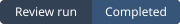

# Review run badge

This example uses a saved SVG with a repository-relative link. The example status and date are illustrative.



1. Open **Audit**, select your repository and choose **Generate README badge**.
2. Choose **Download SVG**. Commit `review-status.svg` beside the repository's root `README.md`.
3. Paste the generated Markdown into that README:

   ```markdown
   
   ```

4. To update the snapshot, choose **Refresh badge**, download the SVG and replace the committed file. Readers can see the badge wherever they can read the repository, without signing in to the review application.

The generator reads the authenticated repository history (`GET /api/v1/repositories/{id}/reviews?days=90&limit=1`). It uses all statuses and pull requests, regardless of the audit table's filters. The API orders runs by creation time in UTC, then ID, both descending. The badge records that run's execution status and includes its creation time in the SVG description. “Completed” means analysis finished and can include findings. Publication and PR approval are separate outcomes.

When the 90-calendar-day window is empty the badge says “None in 90 days”. If history is unavailable, generation and download are unavailable until a successful refresh. The SVG contains no account, repository, commit or code data. GitHub displays the committed snapshot, so exporting again is necessary when the status changes. The development MSW handler marks its synthetic history. Exports from that source display “Demo review run” in the SVG.
